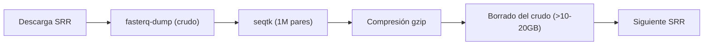

# Pipeline de Análisis Transcriptómico RNA-Seq con Nextflow DSL2 y Migración a AWS Cloud

[](https://www.nextflow.io/)
[](https://www.gnu.org/software/bash/)
[](https://www.r-project.org/)
[](LICENSE)
[]()

> **Proyecto de Bioinformática Traslacional & Cloud Computing:**  
> Implementación integral, reproducible y automatizada de un pipeline de RNA-Seq desde la adquisición de datos crudos hasta el análisis de expresión diferencial (DESeq2), optimizado localmente mediante Nextflow DSL2 y preparado arquitecturalmente para su orquestación distribuida en Amazon Web Services (AWS Batch + S3).

---

## 📑 Tabla de Contenidos
1. [¿De qué trata este proyecto? (Explicación para todos los públicos)](#-de-qu-trata-este-proyecto-explicacin-para-todos-los-pblicos)
2. [El Dataset Biológico](#-el-dataset-biolgico)
3. [Estrategia de Memoria y Descarga Segura](#-estrategia-de-memoria-y-descarga-segura)
4. [Arquitectura del Pipeline](#-arquitectura-del-pipeline)
5. [Estructura del Proyecto y Función de cada Archivo](#-estructura-del-proyecto-y-funcin-de-cada-archivo)
6. [Resultados Biológicos y Salidas Obtenidas](#-resultados-biolgicos-y-salidas-obtenidas)
7. [Cómo Ejecutar el Pipeline en Local](#-cmo-ejecutar-el-pipeline-en-local)
8. [Orquestación y Migración a la Nube (AWS Cloud & Seqera Platform)](#-orquestacin-y-migracin-a-la-nube-aws-cloud--seqera-platform)
9. [Aplicaciones en el Mundo Real](#-aplicaciones-en-el-mundo-real)

---

## 🧬 ¿De qué trata este proyecto? (Explicación para todos los públicos)

Imagina que las células de nuestro cuerpo tienen una biblioteca inmensa con miles de libros de instrucciones: el **ADN**. Sin embargo, una neurona del cerebro no necesita leer los mismos libros que una célula de la piel. Para saber qué instrucciones está usando activamente una célula en un momento determinado, esta hace "fotocopias" de fragmentos de información: estas copias se llaman **ARN mensajero (ARNm)**.

La tecnología de **RNA-Seq** (secuenciación de ARN) funciona como una máquina fotográfica molecular de alta precisión que lee millones de fragmentos diminutos de esas fotocopias (llamados *reads* o lecturas).

### ¿Cuál es el desafío informático?
- Cada muestra genera **decenas de millones de lecturas de texto** (gigabytes de datos de texto en formato FASTQ).
- Los archivos deben ser limpiados de impurezas técnicas, comparados contra un mapa de referencia del genoma completo del ratón (de 2.700 millones de letras) para saber de qué gen proviene cada lectura, y luego contados.
- Finalmente, se aplica estadística avanzada para responder a la pregunta biológica: **¿Qué genes se encienden o apagan cuando se inhibe una molécula reguladora clave?**

Este repositorio automatiza **todo este flujo de principio a fin** usando **Nextflow**, una tecnología que garantiza que el análisis se ejecute de manera idéntica en cualquier ordenador o supercomputador del mundo.

---

## 🐭 El Dataset Biológico

El conjunto de datos proviene de un estudio público del NCBI SRA (**BioProject: [PRJNA1533324](https://www.ncbi.nlm.nih.gov/bioproject/PRJNA1533324)**), enfocado en neurodesarrollo y modelos de exposición prenatal al alcohol (*prenatal alcohol exposure*):

- **Organismo:** Ratón de laboratorio (*Mus musculus*, cepa C57BL/6J).
- **Tejido:** Corteza cerebral embrionaria (día embrionario E18).
- **Secuenciador:** Illumina NovaSeq 6000 (lecturas emparejadas / *paired-end* 2 × 150 pb).
- **Diseño Experimental:** 6 muestras biológicas divididas en 2 grupos:
  - **3 réplicas de Control Negativo:** `SRR40794928`, `SRR40794929`, `SRR40794930`.
  - **3 réplicas de Inhibición de miR-150-5p:** `SRR40794931`, `SRR40794932`, `SRR40794933`.

**Hipótesis biológica a contrastar:**  
Evaluar qué genes corticales modifican su expresión cuando se inhibe el microARN regulador **miR-150-5p** respecto al control negativo.

---

## 💾 Estrategia de Memoria y Descarga Segura

Uno de los principales cuellos de botella al trabajar con datos genómicos en ordenadores personales o portátiles es el **espacio en disco**:
- El dataset crudo completo descomprimido supera los **70 GB**.
- Si se descargaran todas las muestras al mismo tiempo, el disco se llenaría rápidamente provocando un bloqueo del sistema.

### ¿Cómo se solucionó? (Estrategia secuencial con borrado inmediato)
Implementamos un flujo en bucle cerrado mediante un script automatizado en Bash (`download_and_subsample.sh`):



1. **Descarga individual:** Se descarga una única muestra usando `fasterq-dump` con hilos múltiples.
2. **Submuestreo estocástico reproducible:** Con la herramienta `seqtk` y semilla fija (`-s42`), se extrae exactamente **1.000.000 de pares de lecturas** (4.000.000 de líneas por archivo FASTQ).
3. **Compresión gzip:** Las lecturas submuestreadas se comprimen a `*.fastq.gz` (ocupando ~75 MB por archivo).
4. **Limpieza inmediata:** Los archivos temporales no comprimidos (de 10 a 20 GB por muestra) se eliminan del disco **antes** de comenzar la descarga del siguiente accesión.

> **Resultado:** Se obtuvieron las 6 muestras balanceadas ocupando menos de 1 GB en total en el disco, permitiendo ejecutar el análisis localmente.

---

## 🏗 Arquitectura del Pipeline

El pipeline está modularizado siguiendo las mejores prácticas de **Nextflow DSL2**:

```
                          ┌────────────────────────┐
                          │   Samplesheet (CSV)    │
                          └───────────┬────────────┘
                                      │
                         [reads_ch: FASTQ R1 + R2]
                                      │
                   ┌──────────────────┴──────────────────┐
                   ▼                                     ▼
       ┌───────────────────────┐             ┌───────────────────────┐
       │      FASTQC_RAW       │             │      TRIMMOMATIC      │
       │   Control Calidad     │             │  Limpieza Adaptadores │
       │     Pre-Trim          │             │     TruSeq3-PE-2      │
       └───────────────────────┘             └───────────┬───────────┘
                                                         │
                                        [Lecturas limpias R1 + R2]
                                                         │
                                 ┌───────────────────────┴───────────────────────┐
                                 ▼                                               ▼
                     ┌───────────────────────┐                       ┌───────────────────────┐
                     │    FASTQC_TRIMMED     │                       │     HISAT2_ALIGN      │
                     │    Control Calidad    │                       │  Alineamiento a GRCm39│
                     │       Post-Trim       │                       │    + SAMtools sort    │
                     └───────────────────────┘                       └───────────┬───────────┘
                                                                                 │
                                                                       [6 Archivos BAM + BAI]
                                                                                 │
                                                                                 ▼
                                                                     ┌───────────────────────┐
                                                                     │     FEATURECOUNTS     │
                                                                     │ Cuantificación Génica │
                                                                     │      GENCODE vM36     │
                                                                     └───────────┬───────────┘
                                                                                 │
                                                                       [Matriz counts.txt]
                                                                                 │
                                                                                 ▼
                                                                     ┌───────────────────────┐
                                                                     │        DESEQ2         │
                                                                     │ Expresión Diferencial │
                                                                     │   (Script propio R)   │
                                                                     └───────────┬───────────┘
                                                                                 │
                                                      ┌──────────────────────────┴──────────────────────────┐
                                                      ▼                                                     ▼
                                          ┌───────────────────────┐                             ┌───────────────────────┐
                                          │      Volcano Plot     │                             │        PCA Plot       │
                                          │     deseq2_results    │                             │   normalized_counts   │
                                          └───────────────────────┘                             └───────────────────────┘
```

---

## 📂 Estructura del Proyecto y Función de cada Archivo

A continuación se detalla qué hace cada archivo y directorio del repositorio:

```
Pipeline-AWS-Nextflow/
├── .gitignore                      # Reglas de exclusión para Git (ignora archivos gigantes como genomas o BAMs)
├── main.nf                         # Orquestador principal de Nextflow DSL2 que conecta todos los módulos
├── nextflow.config                 # Archivo de configuración global (recursos, perfiles local, docker y aws)
├── environment.yml                 # Especificación del entorno Conda con todas las herramientas bioinformáticas
├── TruSeq3-PE-2.fa                 # Secuencias de adaptadores Illumina TruSeq para el recorte de lecturas
├── SRR_Acc_List.txt                # Lista de accesiones descargadas de NCBI SRA
├── SraRunTable.csv                 # Metadatos experimentales originales de SRA (condición, tejido, etc.)
│
├── modules/                        # Procesos aislados y modulares de Nextflow DSL2
│   ├── fastqc.nf                   # Módulo que ejecuta FastQC y genera reportes HTML y ZIP
│   ├── trimmomatic.nf              # Módulo que recorta adaptadores y filtra bases de baja calidad
│   ├── hisat2.nf                   # Módulo que alinea lecturas al genoma y genera archivos BAM ordenados
│   ├── featurecounts.nf            # Módulo que asigna lecturas a genes y genera la matriz de conteos
│   └── deseq2.nf                   # Módulo que envuelve la ejecución del script analítico en R
│
├── scripts/
│   └── deseq2_analysis.R           # Script en R con Bioconductor para normalización, PCA, Volcano y contrastes
│
├── data/
│   └── samplesheet.csv             # Tabla de manifiesto que mapea cada muestra con sus archivos FASTQ y su grupo
│
└── results/                        # Salidas del análisis ejecutado
    ├── deseq2/                     # Resultados estadísticos y gráficos de expresión diferencial
    │   ├── deseq2_results.csv      # Tabla de resultados con log2FoldChange, p-valor y p-ajustado
    │   ├── normalized_counts.csv   # Conteos génicos normalizados por tamaño de librería
    │   ├── volcano_plot.pdf        # Gráfico de volcán (significancia vs magnitud de cambio)
    │   └── pca_plot.pdf            # Gráfico de componentes principales (agrupamiento de muestras)
    ├── featurecounts/
    │   ├── counts.txt              # Matriz de conteo crudo de todas las muestras (78.239 genes anotados)
    │   └── counts.txt.summary      # Estadísticas de asignación de lecturas a exones
    ├── fastqc/                     # Reportes interactivos de calidad pre y post-trimming
    ├── hisat2/                     # Logs de alineamiento con porcentajes de mapeo global
    ├── trimmomatic/                # Logs con métricas de lecturas retenidas tras el filtrado
    ├── pipeline_report.html        # Reporte de métricas computacionales (CPU, memoria y duración) de Nextflow
    ├── timeline.html               # Gráfico interactivo de la línea temporal de ejecución de cada tarea
    └── trace.txt                   # Tabla de seguimiento técnico de cada proceso
```

---

## 📊 Resultados Biológicos y Salidas Obtenidas

El pipeline completó el 100% de los procesos de manera satisfactoria:

### 1. Rendimiento del Alineamiento y Cuantificación
- **Genoma de referencia:** GRCm39 primary assembly (2.6 GB) con anotación oficial **GENCODE vM36** (1.1 GB).
- **Alineamiento (HISAT2):** Las lecturas recortadas presentaron porcentajes de alineamiento consistentes a lo largo de las 6 muestras.
- **Cuantificación (featureCounts):** Se cuantificaron **78.239 genes**. Tras el pre-filtrado de ruido biológico (retener genes con $\ge 10$ lecturas totales), quedaron **13.668 genes expresados** analizados por DESeq2.

### 2. Expresión Diferencial (DESeq2)
El script de R [`scripts/deseq2_analysis.R`](file:///scripts/deseq2_analysis.R) ejecutó:
- Estimación de factores de escala (*size factors*).
- Estimación y ajuste de dispersión génica con contracción de log2-fold-change mediante `apeglm`.
- **Salidas generadas:**
  - [`results/deseq2/deseq2_results.csv`](file:///results/deseq2/deseq2_results.csv): Listado de todos los genes con sus métricas estadísticas.
  - [`results/deseq2/pca_plot.pdf`](file:///results/deseq2/pca_plot.pdf): Análisis de Componentes Principales con transformación estabilizadora de varianza (VST).
  - [`results/deseq2/volcano_plot.pdf`](file:///results/deseq2/volcano_plot.pdf): Gráfico de volcán marcando los umbrales de significancia ($p_{adj} < 0.05$ y $|log_2FC| \ge 1.0$).

---

## 🚀 Cómo Ejecutar el Pipeline en Local

### Prerrequisitos
- Sistema Linux o **Windows Subsystem for Linux (WSL2 Ubuntu)**.
- [Miniconda](https://docs.conda.io/en/latest/miniconda.html) o Mamba.

### 1. Clonar el repositorio
```bash
git clone https://github.com/menmati/Pipeline-AWS-Nextflow.git
cd Pipeline-AWS-Nextflow
```

### 2. Crear y activar el entorno Conda
```bash
conda env create -f environment.yml
conda activate rnaseq
```

### 3. Ejecutar el pipeline
```bash
nextflow run main.nf -profile local
```

Si deseas reiniciar una ejecución aprovechando el caché de pasos ya completados:
```bash
nextflow run main.nf -profile local -resume
```

---

## ☁️ Orquestación y Migración a la Nube (AWS Cloud & Seqera Platform)

> 💡 **Nota importante sobre costes:**  
> **No es necesario crear una cuenta de AWS ni pagar nada.**  
> Este proyecto incluye toda la arquitectura y los archivos de configuración preparados para la nube mediante **código agnóstico de infraestructura**. Esto significa que el código demuestra cómo se orquesta en la nube sin incurrir en costes reales.

### ¿Cómo funciona la arquitectura en AWS?
Cuando un centro de investigación o una farmacéutica procesa cientos o miles de muestras (terabytes de datos), un ordenador local no tiene suficiente memoria ni procesadores. Aquí es donde entra Nextflow con **AWS**:

```
[Tu Ordenador / Seqera Platform]
        │ (Lanza el comando: nextflow run main.nf -profile aws)
        ▼
   [AWS Batch] ──► Programa y asigna los trabajos a una cola (Queue)
        │
        ├──► Crea una máquina virtual EC2 para FastQC
        ├──► Crea 6 máquinas EC2 simultáneas para HISAT2 (¡alineamiento en paralelo!)
        └──► Crea una máquina con R para ejecutar DESeq2
        │
        ▼
   [Amazon S3] ──► Almacena los FASTQ, el genoma de referencia y los resultados finales
```

### ¿Dónde está configurado en este repositorio?
En el archivo [`nextflow.config`](file:///nextflow.config), en la sección `profiles { aws { ... } }`:

```groovy
profiles {
    aws {
        process.executor  = 'awsbatch'
        process.queue     = 'rnaseq-batch-queue'
        process.container = 'quay.io/biocontainers/...'

        aws {
            region = 'us-east-1'
            batch {
                cliPath = '/home/ec2-user/miniconda3/bin/aws'
                volumes = '/tmp'
            }
        }

        params {
            samplesheet  = 's3://tu-bucket-rnaseq/data/samplesheet.csv'
            genome       = 's3://tu-bucket-rnaseq/genome/genome.fa'
            gtf          = 's3://tu-bucket-rnaseq/genome/annotation.gtf'
            hisat2_index = 's3://tu-bucket-rnaseq/genome/hisat2_index'
            outdir       = 's3://tu-bucket-rnaseq/results'
        }

        workDir = 's3://tu-bucket-rnaseq/work'
    }
}
```

### ¿Por qué esta solución es tan potente?
1. **Separación total entre lógica e infraestructura:** No hay que cambiar ni una sola línea de código en los scripts (`main.nf`, `hisat2.nf`, etc.). Cambiando únicamente el flag `-profile local` por `-profile aws`, Nextflow se encarga de subir las órdenes a AWS Batch, descargar los archivos desde Amazon S3, levantar las máquinas necesarias y guardar los resultados.
2. **Escalabilidad elástica:** Si en lugar de 6 muestras se procesan 600, AWS levanta 600 contenedores en paralelo y el análisis tarda prácticamente el mismo tiempo que una sola muestra.
3. **Integración con Seqera Platform (Nextflow Tower):** Permite monitorizar el coste en dólares, el estado de las tareas y el uso de CPU/memoria desde un panel web interactivo.

---

## 🌍 Aplicaciones en el Mundo Real

Pipelines como este son el estándar utilizado diariamente en:
- **Oncología de Precisión:** Comparar biopsias tumorales contra tejido sano para identificar dianas terapéuticas sobreexpresadas.
- **Desarrollo Farmacéutico:** Evaluar la respuesta transcripcional a nuevos fármacos o tratamientos basados en ARNip/microARN.
- **Enfermedades Raras y Neurobiología:** Determinar el impacto molecular de mutaciones genéticas en el desarrollo cerebral y prenatal (como el estudio del presente dataset).

---

## 📄 Licencia

Este proyecto está bajo la Licencia [MIT](LICENSE) - libre para uso educativo, académico y profesional.
